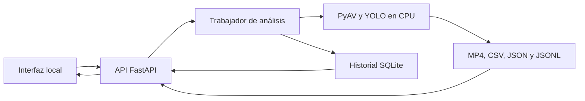

# El Mozart · análisis local de NOX

**Estado al 4 de noviembre de 2026: prototipo local funcional con modelo
experimental; evaluación independiente y entrega final pendientes.**

El objetivo del proyecto es medir la exposición visual de patrocinadores en vídeos
de pádel. Se priorizan ropa y palas, con soportes estáticos en una sección separada.
La primera marca acordada es NOX; el lote actual trabaja la palabra `nox_texto`.

Lo implementado permite obtener propuestas de logos en imágenes y vídeos, subir
un archivo desde el navegador, consultar el estado del análisis, reproducir el
vídeo anotado y descargar CSV e informe JSON. **Todavía no calcula exposición en
segundos ni porcentajes.** Las propuestas no equivalen a detecciones revisadas,
y la confianza del modelo no representa precisión demostrada.

## Qué está hecho y qué queda pendiente

| Bloque | Estado y alcance demostrado |
| --- | --- |
| Datos reales | Lote de 23 imágenes y 21 cajas de `nox_texto`: 19 imágenes de train, 3 de val y 1 de test. Anotaciones aprobadas, manifiesto, hashes y carga de las particiones comprobada. Permisos de reutilización e independencia suficiente pendientes. |
| Diagnóstico sintético | Generador reproducible separado del lote real: 200 imágenes y 134 cajas de referencia. Sirve para diagnóstico técnico; no demuestra fiabilidad sobre vídeos reales ni se utiliza en T05/T10. |
| Entrenamiento T05 | Cuaderno y verificador preparados: permisos, GPU, hash del ZIP, configuración acordada, comprobación de checkpoints y controles contra reintentos accidentales. La nueva ejecución real acordada sigue pendiente. |
| Evaluación T10 | Evaluador e informe preparados: integridad de artefactos, separación de datos, umbral fijado antes del entrenamiento y revisión manual de TP, FP, FN y ambigüedades. Falta ejecutar y revisar el nuevo modelo. |
| Imágenes y vídeo | Inferencia con cajas, nombre y confianza; lectura progresiva de vídeo con timestamps de origen y exportaciones coherentes. Existe una ejecución real documentada con el modelo histórico experimental. |
| Aplicación Mozart | Interfaz local, API FastAPI, un análisis simultáneo, consulta de estado, reproducción, descargas e historial SQLite conservado tras reiniciar. |
| Repositorio | Todo el trabajo versionado consolidado en `dev` y `main`; instalación y CI incluidas. Las ramas integradas se retiraron conservando las carpetas y artefactos locales. |
| Validación del software | 137 pruebas aprobadas sin omisiones y `pip check` correcto, tanto localmente como en CI de ambas ramas para la versión consolidada. |

No se declara completo el nivel esencial: el nuevo entrenamiento, la evaluación
real y la revisión humana siguen pendientes. Los ensayos históricos y la demo
local aportan evidencia de ejecución, sin acreditar calidad aceptada del detector.

## Evidencia de funcionamiento real

El 3 de noviembre se probó Mozart desde el navegador con un checkpoint real
experimental y un archivo local:

| Observación | Resultado registrado |
| --- | --- |
| Duración del vídeo de entrada | 7,17 segundos |
| Fotogramas procesados | 215 |
| Propuestas generadas | 107, sin revisión de calidad completa |
| Tiempo de análisis de la aplicación | 70,36 segundos; no incluye una nueva descarga de TikTok |
| Recorrido comprobado | Subida, reproducción y navegación del MP4 anotado, descarga de CSV y recuperación del historial tras reiniciar |

Estos tiempos corresponden a ese ensayo y equipo, no garantizan tiempos futuros.
El vídeo comparte un fotograma con el entrenamiento: **no es una evaluación
independiente**. El MP4 generado no conserva el audio. La ejecución directa del
script de vídeo y el recorrido por enlace tienen tiempos propios; no se mezclan
con el tiempo de la aplicación indicado arriba.

[Registro de validación de Mozart](docs/local-app-validation-2026-11-03.json) ·
[Registro del procesamiento de vídeo](docs/video-predictions-validation-2026-11-03.json)

## Arquitectura y estructura

La interfaz HTML/CSS/JavaScript se sirve localmente. FastAPI recibe la subida y
registra el trabajo; un trabajador aislado ejecuta el procesamiento en CPU con
PyAV y Ultralytics YOLO. SQLite conserva estados y propuestas, mientras los
archivos de entrada y salida se guardan en la carpeta local de la aplicación.



| Ruta | Contenido |
| --- | --- |
| `app/` | API, gestión de trabajos e interfaz web |
| `scripts/` | Preparación de datos, inferencia, vídeo, entrenamiento, verificación y evaluación |
| `notebooks/` | Cuadernos de Colab para comprobación de entorno y ensayos |
| `tests/` | Pruebas automatizadas de datos, resultados, inferencia, vídeo y contratos web |
| `docs/` | Especificaciones, decisiones, guías y registros de evidencia |
| `.github/workflows/tests.yml` | Instalación de dependencias, FFmpeg, `pip check` y pruebas en CI |
| `local-artifacts/` | Resultados y archivos privados locales; excluidos de Git |

## Instalación y aplicación local

Requiere Python 3.11, Git y FFmpeg/FFprobe en PATH. Desde PowerShell:

```powershell
git clone https://github.com/fer-trk/project-ai-computer-vision-objects.git
cd project-ai-computer-vision-objects
py -3.11 -m venv .venv
.\.venv\Scripts\python.exe -m pip install --upgrade pip
.\.venv\Scripts\python.exe -m pip install -r requirements-app.txt
.\.venv\Scripts\python.exe scripts/serve_local.py --model "ruta/al/best.pt"
```

Abrir **http://127.0.0.1:8000**. La instalación inicial necesita internet.
El checkpoint local debe tener una clase
`nox_texto`. Los pesos y vídeos no se incluyen en Git. La aplicación no descarga
un modelo alternativo y escucha solo en este equipo.

Para recuperar el mismo historial, arrancar con la misma carpeta de datos; la
predeterminada es `local-artifacts/local-app/`. El servidor se detiene con Ctrl+C.
Consultar `/openapi.json` para el contrato de la API o `/docs` para su visor; el
visor requiere recursos externos, aunque la interfaz principal se sirve localmente.

## Demo en vivo y archivos necesarios

La presentación mostrará una ejecución real del sistema. El vídeo local es la
entrada del análisis; no se sustituye la demostración por una grabación de la app.

Antes de ensayar en otro ordenador se necesitan, además del código:

- El checkpoint real experimental compatible, obtenido por un canal privado
  autorizado. Su SHA-256 figura en el registro de validación de Mozart.
- Un vídeo local cuyo uso esté autorizado y sea compatible con los límites.
  El registro identifica el vídeo histórico y su hash para comparar la copia.
- Dependencias instaladas, FFmpeg/FFprobe disponibles y espacio para los resultados.

Clonar el repositorio no recupera esos archivos. Comprobar su integridad con
`Get-FileHash "ruta/al/archivo" -Algorithm SHA256` y contrastar el resultado con el
manifiesto correspondiente; no usar un modelo ficticio para simular el recorrido.

1. Arrancar el servidor y abrir la interfaz.
2. Seleccionar **Desde mi equipo**, cargar el vídeo y mostrar los parámetros.
3. Iniciar el análisis y observar sus estados hasta que termine.
4. Reproducir el resultado, consultar las propuestas y descargar CSV o JSON.
5. Explicar los fallos y límites observados, sin presentar las propuestas como
   exposición confirmada ni el número de propuestas como precisión del detector.

No se promete procesamiento a la velocidad de reproducción. Para reproducir el
ensayo en el ordenador de presentación falta comprobar ese recorrido allí.

Límites iniciales configurables: **100 MiB por archivo, 60 segundos de vídeo,
2.073.600 píxeles por fotograma y un análisis simultáneo**. El trabajador tiene
un límite de 900 segundos. No son compromisos finales de rendimiento del producto.

También se admiten enlaces públicos de TikTok, pero la descarga nueva falló en el
ensayo documentado. El recorrido histórico por enlace utilizó una copia local
verificada; no garantiza que una descarga futura funcione. La demo usa un archivo
local y comunica los errores reales si aparecen.

[Instalación, límites, API e historial](docs/local-app.md) ·
[Evidencia histórica de la aplicación](docs/local-app-validation-2026-11-03.json)

## Herramientas y pruebas

Para usar solo las herramientas de datos, sin instalar el detector ni la web, crear
un entorno virtual separado e instalar `requirements-tools.txt`. En Git Bash de
Windows se activa con `source .venv/Scripts/activate`; en PowerShell se puede usar
directamente `.\.venv\Scripts\python.exe`. No combinar ambos archivos de requisitos
en un mismo entorno: tienen dependencias fijadas para alcances distintos.

La suite completa, incluida la aplicación, utiliza `requirements-app.txt`:

```powershell
.\.venv\Scripts\python.exe -m unittest discover -s tests -v
.\.venv\Scripts\python.exe -m pip check
```

La consolidación [d321563](https://github.com/fer-trk/project-ai-computer-vision-objects/commit/d32156333cab780f8ae9802b8672d7cf2e5caa78)
pasó **137 pruebas sin omisiones** y `pip check` localmente y en
[CI de dev](https://github.com/fer-trk/project-ai-computer-vision-objects/actions/runs/41873737797)
y [CI de main](https://github.com/fer-trk/project-ai-computer-vision-objects/actions/runs/41873750122).
Los cinco cuadernos y sus 33 celdas de código se comprobaron sintácticamente y
no contienen salidas guardadas. Los recuentos de pruebas de los registros del
3 de noviembre son históricos; no sustituyen el resultado de la suite integrada.

Las pruebas de contratos web usan resultados controlados; las de T05/T10 simulan
entrenamiento o predicción. También hay pruebas de carga real de checkpoints en
CPU. Ninguna de estas comprobaciones equivale a entrenar el nuevo detector ni a
medir su calidad sobre datos independientes. El entrenamiento de Colab mantiene
su entorno separado; no se entrena en CI.

## Pendientes y límites de la entrega

El cierre de esta etapa se centra en ensayar Mozart en vivo, completar la
documentación, respaldar los activos de demo, preparar la presentación y reflejar
el estado real en Kanban. Ese cierre no acredita los requisitos que faltan:

- Documentar permisos de reutilización y completar las decisiones de alcance y
  criterios de calidad. El test actual es una imagen positiva ya inspeccionada:
  no es ciego ni suficiente para demostrar generalización; faltan ejemplos
  independientes y negativos adecuados para la evaluación.
- Ejecutar una sola vez el nuevo T05 en GPU gratuita, con los controles acordados,
  y conservar cuaderno ejecutado, pesos, configuración y resultados verificados.
- Ejecutar T10 con un checkpoint válido y completar la revisión humana y su informe.
- Clasificar claridad y soporte, y medir segundos y porcentaje de exposición
  separando ropa/palas de soportes estáticos.
- Completar el detector multimarca y la persistencia con recortes. Dos variantes
  de NOX no equivalen a dos marcas.
- Completar y aceptar la API del producto, el despliegue cloud gratuito y la
  validación desde otro cliente. La API local existente no acredita el requisito cloud.
- Completar respaldo de los activos de demo, ensayo en el equipo de presentación,
  presentación técnica y aceptación final.

Las especificaciones y la planificación conservan las decisiones abiertas. El
detalle y la secuencia de avances se mantienen en las issues; tener código
integrado o un prototipo funcional no implica que todas estén terminadas.

[Especificaciones](docs/specs.md) · [Plan](docs/plan.md) ·
[Guía T05](docs/t05-one-run.md) · [Guía T10](docs/t10-one-run-evaluation.md) ·
[Procesamiento de vídeo](docs/video-predictions.md) ·
[Kanban](https://github.com/users/fer-trk/projects/1)

[Dataset y particiones](docs/nox-text-dataset-2026-11-03.md) ·
[Aprobación de anotaciones](docs/nox-text-training-approval-2026-11-03.json) ·
[Diagnóstico sintético](data-synthetic/nox-text-diagnostic/README.md)

## Datos y modelos

Datasets reales, vídeos, pesos y resultados permanecen fuera del repositorio.
`local-artifacts/local-app/` contiene vídeos, resultados e historial: no publicarlo.
El respaldo privado verificado cubre el dataset y sus registros; no acredita
respaldo de los vídeos originales ni de modelos históricos.

## Contribución y licencia

Usar ramas breves, Conventional Commits, revisión y pruebas antes de integrar.
No añadir secretos, `.env`, medios sin licencia ni pesos. La licencia del proyecto
y las condiciones completas de distribución de los datos siguen pendientes de
definición; no se declara una licencia que no se haya acordado.
